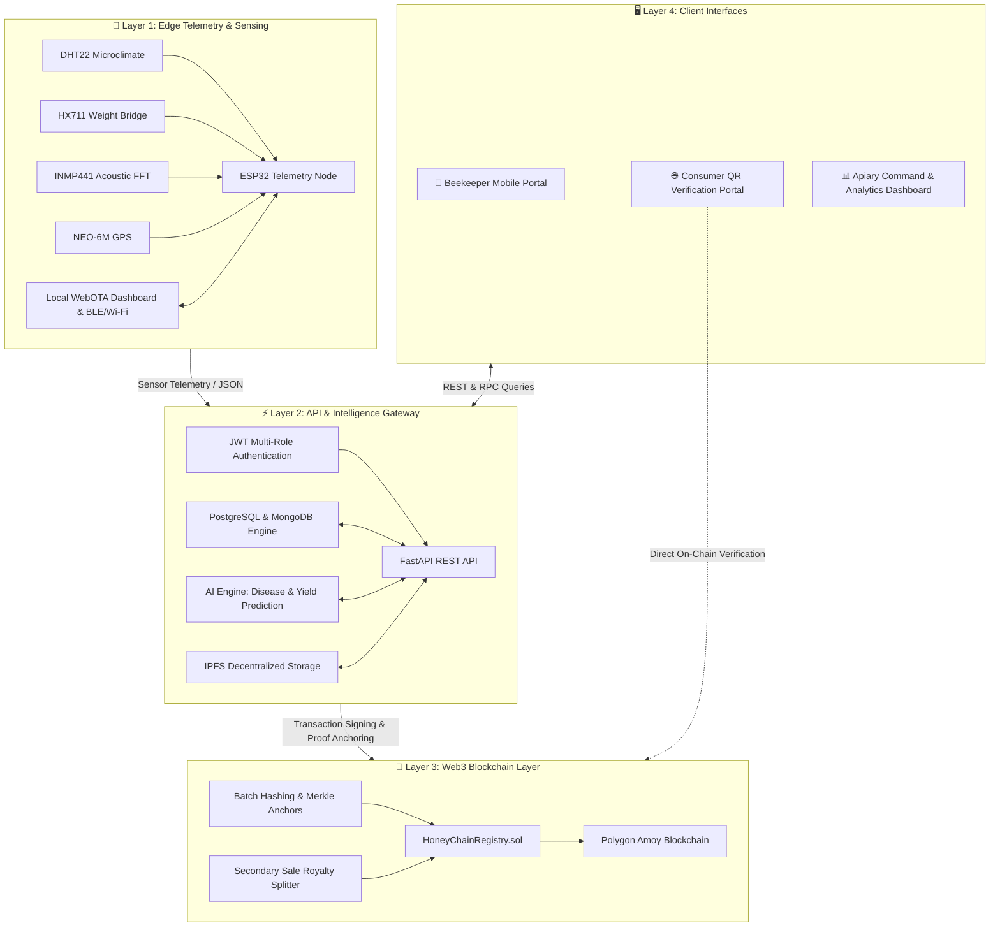

<div align="center">

# 🍯 HoneyChain
### **Next-Gen Decentralized Honey Traceability, Fair-Trade Royalty & Smart Apiculture Ecosystem**

> *Transforming honey supply chains: Empowering beekeepers with immutable provenance, fair secondary-sale royalties, and real-time edge telemetry.*

[](https://opensource.org/licenses/MIT)
[](https://polygon.technology/)
[](https://soliditylang.org/)
[](https://fastapi.tiangolo.com/)
[](https://nextjs.org/)
[](https://www.espressif.com/)
[](https://www.tensorflow.org/)

</div>

---

## 🌟 Executive Summary

The global honey industry is plagued by counterfeiting, sugar-syrup adulteration, and opaque supply chains. While commercial brands sell honey at steep premiums, **primary beekeepers are routinely shortchanged**, receiving negligible upfront payments with zero share in downstream retail or export profits.

**HoneyChain** is an end-to-end Web3, AI, and IoT infrastructure that solves this crisis:
1. **Immutable Cryptographic Provenance**: Every batch receives an on-chain identity linked to cryptographic proofs of origin, lab purity reports, and hive sensor telemetry.
2. **Autonomous Secondary-Sale Royalties**: Built-in smart contract royalty enforcement ensures that whenever an aggregator, brand, or exporter relabels and resells honey at higher valuations, a programmable percentage is automatically credited back to the original beekeeper.
3. **Hardware-Secured Edge Intelligence (IoT)**: ESP32 edge telemetry nodes running in-hive continuous monitoring for ambient temperature, humidity, load cell weight gain, GPS geolocation anti-theft tracking, and acoustic FFT colony health classification.
4. **AI-Powered Diagnostics**: Computer vision models for early detection of destructive bee conditions (Varroa destructor, Foulbrood) and predictive models forecasting harvest yields.

---

## 🚀 Key Innovation Highlights

| Innovation | Technical Implementation | Impact |
|:---|:---|:---|
| **🔗 On-Chain Batch Anchoring** | Polygon Smart Contracts (`HoneyChainRegistry.sol`) | Eliminates counterfeiting via tamper-evident Merkle/SHA-256 batch hashes. |
| **💰 Programmable Fair-Trade Royalties** | Automated protocol fee & split mechanisms on secondary sales | Protects rural producers against predatory intermediary markups. |
| **📡 Edge Telemetry & FFT Bio-Acoustics** | ESP32 + INMP441 I2S Mic + `arduinoFFT` library | Real-time swarming alerts & hive activity analysis without human disruption. |
| **⚖️ Micro-Precision Weight Tracking** | HX711 24-bit ADC + Precision Load Cell | Tracks nectar accumulation rates and informs optimal harvest windows. |
| **📍 Anti-Theft & Geolocation Mapping** | NEO-6M GPS integration over hardware serial | Real-time migration tracking and apiary security. |
| **🌐 Embedded Local Command Center** | ESP32 Async WebServer + WebOTA + Chart.js | Offline-first dashboard accessible directly via local AP or Wi-Fi mesh. |
| **📱 Frictionless Consumer Verification** | Next.js QR verification portal + IPFS storage | Transparent glass-box verification directly on consumer smartphones. |

---

## 📸 Edge Hardware & Prototype Gallery

HoneyChain includes an operational edge sensing node tailored for rigorous field deployment.

### 🔬 Full Circuitry & Colony Integration
<div align="center">

| Full Circuit Breadboard Prototyping | Load Cell Hive Platform Integration |
|:---:|:---:|
|  |  |
| *Integrated ESP32 telemetry breadboard with sensor array* | *Sub-hive load-cell tare platform for live colony weight tracking* |

</div>

### 🧩 Core Sensor & Module Breakdown
<div align="center">

| **HX711 24-bit ADC Amplifier** | **NEO-6M Precision GPS Module** |
|:---:|:---:|
|  |  |
| *Amplifies microvolt bridge signals from hive load cells* | *High-sensitivity satellite tracking & anti-theft alerts* |

| **DHT22 Microclimate Sensor** | **INMP441 I2S Digital Microphone** |
|:---:|:---:|
|  |  |
| *Measures brood comb temperature & humidity stability* | *Captures acoustic frequency signatures for FFT bee analytics* |

| **ESP32 Dual-Core Microcontroller** |
|:---:|
|  |
| *Handles sensor acquisition, edge audio FFT, and WebOTA dashboard* |

</div>

### 🔌 Hardware Pinout Configuration

<div align="center">
  
</div>

<br/>

| Component | Pin / Function | ESP32 GPIO | Operating Voltage | Description |
|:---|:---|:---|:---|:---|
| **DHT22** | DATA | GPIO 18 | 3.3V | Temperature & humidity digital bus |
| **HX711** | DOUT (Data) | GPIO 4 | 3.3V / 5V | 24-bit serial data line |
| **HX711** | SCK (Clock) | GPIO 16 | 3.3V / 5V | Clock pulses for serial readout |
| **NEO-6M GPS** | TX → ESP32 RX | GPIO 33 | 3.3V / 5V | NMEA serial telemetry stream |
| **NEO-6M GPS** | RX ← ESP32 TX | GPIO 32 | 3.3V / 5V | Configuration stream |
| **INMP441 Mic** | SCK (Bit Clock) | GPIO 2 | 3.3V | I2S serial audio clock |
| **INMP441 Mic** | WS (Word Select) | GPIO 15 | 3.3V | Left/Right audio channel frame |
| **INMP441 Mic** | SD (Serial Data) | GPIO 17 | 3.3V | Digital audio data line |

---

## 🏛️ System Architecture



---

## 💻 Tech Stack

- **Blockchain & Web3**: Solidity `^0.8.20`, Hardhat, Ethers.js, Polygon Amoy Testnet, IPFS.
- **Embedded Hardware & IoT**: ESP32 WROOM-32, DHT22, HX711, NEO-6M GPS, INMP441 I2S, `arduinoFFT`, AsyncWebServer, WebOTA.
- **Backend Core**: FastAPI (Python 3.11), SQLAlchemy, PostgreSQL, MongoDB, Pydantic, Uvicorn.
- **Artificial Intelligence**: TensorFlow, PyTorch, Scikit-learn, OpenCV, TFLite edge models.
- **Frontend & Applications**: Next.js 14, React 18, Tailwind CSS, Chart.js, Lucide Icons.
- **DevOps & Infrastructure**: Docker, Docker Compose, AWS S3, GitHub Actions.

---

## 📁 Repository Structure

```text
Honey-Chain/
├── blockchain/           # Hardhat development environment, contracts & test suites
│   ├── contracts/        # HoneyChainRegistry.sol & verification contracts
│   ├── scripts/          # Automated deployment & verification scripts
│   └── test/             # Comprehensive smart contract unit tests
├── backend/              # FastAPI production backend microservice
│   ├── app/              # Routes, controllers, database models, and schemas
│   ├── docker-compose.yml# Containerized database & API orchestration
│   └── requirements.txt  # Python service dependencies
├── iot-simulator/        # ESP32 firmware, pinouts & hardware documentation
│   ├── HoneyChain_hive_IoT.ino # ESP32 production firmware with FFT & WebOTA
│   ├── Final pinout img.jpeg   # Complete annotated schematic
│   └── *.jpeg            # High-resolution hardware setup photos
├── consumer-web/         # Next.js customer-facing batch verification portal
├── frontend/             # Beekeeper & administrative management dashboard
├── ai-models/            # Computer vision & yield predictive models
└── README.md             # Complete project documentation
```

---

## 🏁 Quickstart Guide

### 1. Smart Contract Deployment (Polygon Amoy)
```bash
cd blockchain
npm install
npx hardhat compile
npx hardhat run scripts/deploy.js --network amoy
```

### 2. Backend API Services
```bash
cd backend
cp .env.example .env
# Fill your Polygon RPC and Database credentials
docker-compose up -d --build
```
API Documentation will be live at `http://localhost:8000/docs`.

### 3. Consumer QR Verification Portal
```bash
cd consumer-web
npm install
npm run dev
```
Navigate to `http://localhost:3000` to simulate batch scanning and audit verification.

### 4. ESP32 Edge Firmware Flashing
1. Open the [Arduino IDE](https://www.arduino.cc/en/software).
2. Install libraries: `DHT sensor library`, `HX711 Arduino Library`, `TinyGPSPlus`, `arduinoFFT`.
3. Open `iot-simulator/HoneyChain_hive_IoT.ino`.
4. Configure your local Wi-Fi credentials:
   ```cpp
   const char* ssid = "YOUR_WIFI_SSID";
   const char* password = "YOUR_WIFI_PASSWORD";
   ```
5. Select board **ESP32 Dev Module** and click **Upload**.
6. Access the live telemetry console at `http://<ESP32_IP>`.

---

## 🛡️ Smart Contract Architecture

The core contract [`HoneyChainRegistry.sol`](./blockchain/contracts/HoneyChainRegistry.sol) guarantees:
- **`registerBatch(bytes32 batchHash, string ipfsUri, uint256 basePrice)`**: Enforces the permanent record of honey origin, apiary coordinates, and laboratory certificates.
- **`recordSecondarySale(bytes32 batchHash, uint256 salePrice)`**: Automatically computes and deposits the beekeeper's royalty split upon resale.
- **`verifyBatch(bytes32 batchHash)`**: Instant, gasless public view function for consumers to validate authenticity directly against the blockchain state.

---

## 📜 License

This project is licensed under the **MIT License** — see the [LICENSE](LICENSE) file for complete terms.
